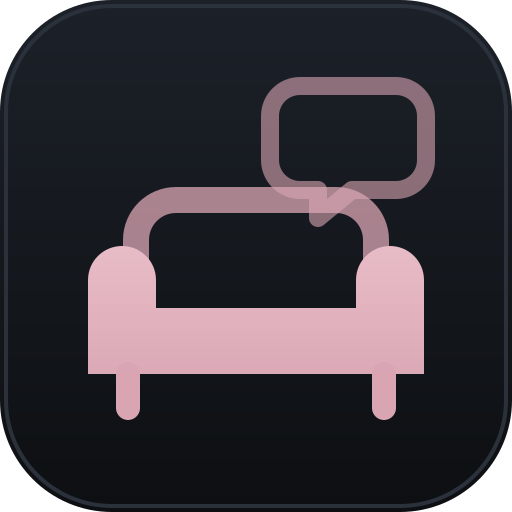

<p align="center"></p>

# The Couch: a therapist simulator for the long way round

An [AirplaneMode](https://github.com/jessewolcott/airplanemode) app. Pick a "therapist" whose
outlook comes from a school of thought, lie back, and talk things through on a long flight.
It runs on the box's shared language model, and it still works (more simply) without one.

**It's a toy for reflection and fun, not therapy.** The page says so, it never diagnoses or
prescribes, and anything that sounds like a crisis gets a fixed, caring reply with real crisis
lines instead of the model (see [Safety](#safety)).

Screenshots: to come.

## The therapists

- **Aurelia · Stoicism.** Calm and warm. Sorts what's in your control from what isn't, questions
  the story you tell about events, and offers the view from above, negative visualization,
  amor fati and an evening review. Quotes Epictetus, Marcus Aurelius and Seneca (George Long and
  Richard Gummere's public-domain translations).
- **Robin · Socialism.** Warm and practical. Reads personal troubles through material
  conditions: alienation at work, precarity, private troubles vs public issues (C. Wright
  Mills), mutual aid and acting together, and pushes back on self-blame and hustle culture.
  Always ends on a concrete next step. Quotes William Morris, Kropotkin, Wilde, Debs and the
  labour movement; Marx's 1844 manuscripts and Mills (no public-domain translations/texts) are
  paraphrased and marked as such. Never talks about current politicians or parties.

## Using it

1. Choose a therapist (and, if you like, give a first name).
2. Talk. Replies stream in word by word; the on-board model is slow (5–15 words a second on
   the R6S), so there's a typing indicator while it thinks.
3. The menu (⋯) has **End session** (a short summary and one thing to try, in the school's
   style), **Switch therapist** (the new one picks up where you were), **Export as text**,
   **Real help** (crisis lines) and **Forget this conversation**.

The conversation lives **only in your browser** (localStorage). The box keeps nothing and
logs no message text: each message is sent with the recent turns, answered, and forgotten.

## How it works

- **The model** (`LLM_URL`, llama.cpp's OpenAI-compatible API, `stream: true`). The server
  builds the prompt: the school's system prompt plus shared rules (never diagnose, never
  name medication, never claim to be a professional, steer to real help), one example reply
  for tone, a short running summary of any turns that no longer fit, as many recent turns
  as fit the token budget (1600 by default: the 4096 context is shared by 2 slots), and a
  one-line nudge with the school's angle on the theme you're talking about. `cache_prompt`
  is on and the fixed part comes first, so the slot cache can reuse it.
- **Output checks.** Before anything is shown: role-play of your lines is cut off, "As an AI"
  boilerplate, claims to be licensed, diagnoses, medication and doses are dropped, quotes that
  aren't in the school's file are dropped (a small model invents Seneca lines), sentences it
  already said are dropped, and replies are capped at about 150 words on a sentence boundary.
  Requests for a quote are answered from the school file, never from the model.
- **The offline mind.** With no model (`LLM_URL` empty, e.g. the GL.iNet profile), or when
  it's unreachable, loading, or too busy to start answering within `LLM_TIMEOUT`, a rule-based
  responder answers: it spots themes (work, family, relationships, anxiety, sleep, travel,
  loneliness, anger, grief, money) and intents (hello, thanks, "what should I do?", "give me a
  quote"), reflects your own words back, and adds the school's angle, a question, and now and
  then a quote or a technique, all from the school's file, without repeating itself. The page
  labels it gently. After a model failure it's used for 30 s before the model is tried again.

## Safety

Every message is checked on the server, before anything else, by a deterministic pattern
check (`safety.py`) for signs of suicide or self-harm, harm to others, abuse, or a medical
emergency. If it trips, the reply is a fixed caring message (never model-generated) that
encourages contacting local emergency services or a crisis line, and the page shows a card
with 988 (US and Canada), Samaritans 116 123 (UK and Ireland), 112/911 and findahelpline.com.
The conversation can carry on, and the model is told to stay gentle and keep pointing to real
help. Common figures of speech ("this flight is killing me") are allowed for, but the check
errs on the side of showing resources. The tests hold a list of phrases that must and must not
trip it; add to both when you change it.

## Adding a school

A school is one JSON file in `schools/` named after its id (`schools/existentialism.json`).
Copy `schools/stoicism.json` and change everything:

| Field | What it is |
|---|---|
| `id`, `order` | file name without `.json`; position on the start screen |
| `name`, `therapist`, `tagline`, `description` | the school, the therapist's name, the card text |
| `accent`, `accent2` | `#rrggbb` colours for the card and the chat |
| `avatar` | one inline `<svg>` (no scripts, links or external URLs; under 6 KB) |
| `system_prompt` | the persona and outlook, 200–1500 characters (shared safety rules are added) |
| `examples` | 1–3 `{user, reply}` pairs; the reply sets the tone (keep it under 120 words) |
| `opening_lines`, `handoff_lines` | first words of a session (`{, name}` becomes ", Sam" or nothing); taking over from `{prev}` |
| `techniques` | at least 4 `{id, name, how, themes}` |
| `quotes` | at least 6 `{text, source, themes}`, short and accurate, public domain; add `"paraphrase": true` when it's your wording |
| `reflections` | for each theme and `general`: `angles` (statements) and `questions` (ending in `?`), at least 3 each |
| `small_talk` | `greeting`, `thanks`, `goodbye`, `unsure`, `who`, `advice`, `short` (at least 2 each) |
| `closing` | `style` (for the model's summary), `summary_lines` (with `{themes}`), `farewells` |

The app refuses to start if a file is incomplete, and the tests check every file. Set
`SCHOOLS_DIR` to load schools from a mounted folder instead of the bundled ones.

## Running it

**On the box:** the platform repo runs the released image at `/couch/`, with `LLM_URL`
pointing at the shared model.

**On its own, for development:**

```
docker compose up -d --build       # http://localhost:8774 (offline mind unless LLM_URL is set)
python tests/test_couch.py         # tests (CI runs these before building)
```

## Settings

| Variable | Default | Meaning |
|---|---|---|
| `LLM_URL` | `http://llm:8080` | the shared model; empty = offline mind only |
| `LLM_TIMEOUT` | `45` | seconds to wait for the model's first word before the offline mind answers |
| `MAX_TOKENS` | `220` | longest model reply, in tokens |
| `PROMPT_TOKENS` | `1600` | token budget for what's sent to the model |
| `MAX_STREAMS` | `2` | replies streamed from the model at once; others wait up to `QUEUE_WAIT` (15 s) |
| `LLM_GAP_TIMEOUT` | `20` | seconds of silence mid-reply before keeping what arrived |
| `LLM_COOLDOWN` | `30` | seconds to use the offline mind after the model fails |
| `SCHOOLS_DIR` | bundled `schools/` | where school files are loaded from |

No volume: it stores nothing. Memory limit 64 MB (about 35 MB in use).

*Not yet tested on real hardware.* The model path was tried against Qwen2.5-1.5B-Instruct on
a desktop (the platform dev stack); speeds on the R6S are unmeasured.
