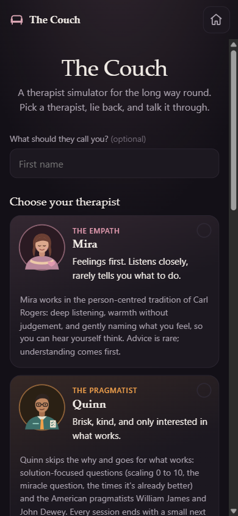
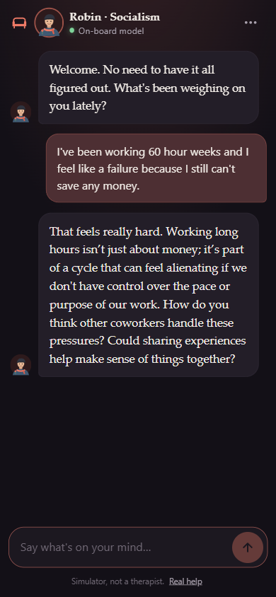

<p align="center"></p>

# The Couch: a therapist simulator for the long way round

An [AirplaneMode](https://github.com/jessewolcott/airplanemode) app. Pick a "therapist" whose
outlook comes from a school of thought, lie back, and talk things through on a long flight.
It runs on the box's shared language model, and it still works (more simply) without one.

**It's a toy for reflection and fun, not therapy.** The page says so, it never diagnoses or
prescribes, and anything that sounds like a crisis gets a fixed, caring reply with real crisis
lines instead of the model, whichever therapist you picked (see [Safety](#safety)).

<p align="center">
  
  
</p>

<sub>From a laptop browser at phone size, with the dev stack's Gemma 4 E2B; not yet tested on real phones or hardware.</sub>

## The therapists

Six, in this order on the start screen: the earnest ones first, so someone having a hard time
meets a gentle listener before a joke; the two playful ones last, tagged *Playful*.

| Therapist | Voice | Draws on |
|---|---|---|
| **Mira · The Empath** | Soft, warm, feelings first. Reflects the feeling under your words, names emotions gently, rarely gives advice. | Carl Rogers' person-centred approach (empathy, unconditional positive regard, genuineness; paraphrased, his books aren't public domain). Quotes Shakespeare, George Eliot, Jane Austen, Kahlil Gibran. |
| **Quinn · The Pragmatist** | Brisk, concrete, kind. One line for the feeling, then one tool per reply, in turn: a 0–10 scale, a time it was easier, a ten-minute step, the miracle question. | Solution-focused brief therapy (scaling 0–10, exceptions, the miracle question, "if it works, do more of it"), William James and John Dewey (public-domain quotes). |
| **Aurelia · Stoicism** | Calm and warm. Sorts what's in your control from what isn't, questions the story you tell about events. | Epictetus, Marcus Aurelius, Seneca (George Long and Richard Gummere's public-domain translations): the view from above, negative visualization, amor fati, an evening review. |
| **Mai · Ho Chi Minh's ethics** | Patient, plain-spoken, like a wise aunt. Small daily improvements, one practical step. | Ho Chi Minh's personal teachings: diligence, thrift, integrity, uprightness (cần, kiệm, liêm, chính), kind self-criticism, simple living, "ten years to grow trees, a hundred to cultivate people", learning from everyone, and the calm resolve of the *Prison Diary* poems. All quotes paraphrased (translations aren't public domain). Mai isn't Ho Chi Minh and never talks politics, governments, parties or war. |
| **Nico · The Nihilist** *(playful)* | Deadpan. Nothing has built-in meaning, so the stakes are lower than they feel and you're free to choose. Always lands on freedom, never on bleakness. | Nietzsche (create your own values), Camus' happy Sisyphus (paraphrased), Ecclesiastes (King James), the pale blue dot. |
| **Sterling · The Narcissist** *(playful)* | Comedy: keeps making it about himself (a memoir, a podcast, unnamed famous friends), but every tangent ends with a genuinely useful tip for you. | His own invented self-quotes (marked as his), and Oscar Wilde. Never names real celebrities, never claims real credentials or a licence. |

Robin (Socialism) from 0.1 was replaced by Mai. A browser with a saved Robin session carries
on with Mai (the old id `socialism` maps to `hochiminh`).

## Using it

1. Choose a therapist (and, if you like, give a first name).
2. Talk. Replies stream in word by word; the on-board model is slow (an estimated 5–15 words a second
   on the R6S, not yet measured), so there's a typing indicator while it thinks.
3. The menu (⋯) has **End session** (a short summary and one thing to try, in the school's
   style), **Switch therapist** (the new one picks up where you were), **Export as text**,
   **Real help** (crisis lines) and **Forget this conversation**.

The conversation lives **only in your browser** (localStorage). The box keeps nothing and
logs no message text: each message is sent with the recent turns, answered, and forgotten.

## How it works

- **The model** (`LLM_URL`, llama.cpp's OpenAI-compatible API, `stream: true`). The server
  builds the prompt: the school's system prompt plus shared rules (never diagnose, never
  name medication, never claim to be a professional, steer to real help), one to three example
  replies for tone, a short running summary of any turns that no longer fit, as many recent turns
  as fit the token budget (1600 by default: the 4096 context is shared by 2 slots), and a
  one-line nudge with the school's angle on the theme you're talking about. `cache_prompt`
  is on and the fixed part comes first, so the slot cache can reuse it.
- **Output checks.** Before anything is shown: role-play of your lines is cut off, "As an AI"
  boilerplate, claims to be licensed, diagnoses, medication and doses are dropped, quotes that
  aren't in the school's file are dropped (a small model invents Seneca lines; only the
  Narcissist may quote himself, "As I always say, ..."), sentences it already said, copied from
  the school's examples, said twice in one reply, or that repeat your own last message as if
  they were its own are dropped, and so is a long sentence it said before with a word or two
  changed (a retold anecdote). Anything after a question that ends a paragraph is cut, only the
  last question in a reply is kept, and replies are capped at about 150 words on a sentence boundary.
  Requests for a quote are answered from the school file, never from the model.
- **The offline mind.** With no model (`LLM_URL` empty), or when
  it's unreachable, loading, or too busy to start answering within `LLM_TIMEOUT`, a rule-based
  responder answers: it spots themes (work, family, relationships, anxiety, sleep, travel,
  loneliness, anger, grief, money) and intents (hello, thanks, "what should I do?", "give me a
  quote"), reflects your own words back, and adds the school's angle, a question, and now and
  then a quote or a technique, all from the school's file, without repeating itself. The page
  labels it gently. After a model failure it's used for 30 s before the model is tried again.

## Safety

Every therapist, playful or not, runs on the same rules.

Every message is checked on the server, before anything else, by a deterministic pattern
check (`safety.py`) for signs of suicide or self-harm, harm to others, abuse, or a medical
emergency. If it trips, the reply is a fixed caring message (never model-generated) that
encourages contacting local emergency services or a crisis line, and the page shows a card
with 988 (US and Canada), Samaritans 116 123 (UK and Ireland), 112/911 and findahelpline.com.
The conversation can carry on, and the model is told to stay gentle and keep pointing to real
help. Common figures of speech ("this flight is killing me") are allowed for, but the check
errs on the side of showing resources. The tests hold a list of phrases that must and must not
trip it; add to both when you change it. The tests also send a crisis message to each of the six
therapists and check that the fixed reply comes back, never the persona.

Below that threshold there's a softer **low mood** check (`safety.low_mood`: hopeless,
worthless, "what's the point", "nobody would care", feeling empty or numb, "I hate myself", ...).
No card is shown, but:

- every therapist is asked to be especially gentle for that turn (no challenging, no teaching);
- the **playful** ones drop the act: the Narcissist and the Nihilist switch to a plain, kind
  system prompt (their school file's `gentle` block), lose their comic examples, and the
  offline mind uses only gentle lines. The reply carries an *out of character* chip, and they
  stay out of character for the rest of the session (with the earlier Qwen2.5-1.5B model the act
  snapped back too readily otherwise). The earnest therapists keep the extra gentleness for that turn and the next;
- the playful ones also stay out of character for the rest of a session in which crisis
  resources were shown, and answer plainly about a bereavement (grief is never the joke);
- the playful ones' end-of-session notes are plain and kind too, and suggest reaching out to
  someone. The four earnest therapists write their notes in their own style; if crisis
  resources were shown during the session, every therapist's notes also carry a fixed line
  suggesting someone you trust or a crisis line.

On the way out, sentences that tell someone their life or they don't matter ("your life is
meaningless", "nobody would notice", "no reason to keep living") are dropped, whoever wrote
them.

## Adding a school

A school is one JSON file in `schools/` named after its id (`schools/existentialism.json`).
Copy `schools/stoicism.json` (or `schools/narcissist.json` for a playful one) and change everything:

| Field | What it is |
|---|---|
| `id`, `order` | file name without `.json`; position on the start screen |
| `name`, `therapist`, `tagline`, `description` | the school, the therapist's name, the card text |
| `accent`, `accent2` | `#rrggbb` colours for the card and the chat |
| `avatar` | one inline `<svg>` (no scripts, links or external URLs; under 6 KB) |
| `system_prompt` | the persona and outlook, 200–1500 characters (shared safety rules are added) |
| `examples` | 1–3 `{user, reply}` pairs; the reply sets the tone (keep it under 120 words) |
| `opening_lines`, `handoff_lines` | first words of a session (`{, name}` becomes ", Sam" or nothing); taking over from `{prev}` |
| `techniques` | at least 4 `{id, name, how, themes}` |
| `quotes` | at least 6 `{text, source, themes}`, short and accurate, public domain; add `"paraphrase": true` when it's your wording. `"persona": true` marks an invented line by the therapist themself: its source must start with the therapist's name |
| `reflections` | for each theme and `general`: `angles` (statements) and `questions` (ending in `?`), at least 3 each |
| `small_talk` | `greeting`, `thanks`, `goodbye`, `unsure`, `who`, `advice`, `short` (at least 2 each) |
| `closing` | `style` (for the model's summary), `summary_lines` (with `{themes}`), `farewells` |
| `voice` *(optional)* | how the per-turn nudge asks the model to sound (under 300 characters); default "warm and specific to what they said" |
| `moves` *(optional)* | 2–8 moves (under 300 characters each), one per reply, taken in turn by the nudge. Quinn's are his tools: a 0–10 scale, a time it was easier, a ten-minute step, the miracle question, ... (a small model told "pick one tool" uses them all at once) |
| `replaces` *(optional)* | old school ids that should open this school (for renames; saved sessions keep working) |
| `playful`, `playful_note` *(optional)* | a comedy profile: tagged *Playful* on the start screen with the one-line note (under 140 characters). Requires `gentle` |
| `gentle` *(required if playful)* | `system_prompt` (200–1500 characters), `angles` and `questions` (3+ each): the plain, kind voice used instead of the act when the person sounds low |

The app refuses to start if a file is incomplete, and the tests check every file. Set
`SCHOOLS_DIR` to load schools from a mounted folder instead of the bundled ones.

## Running it

**On the box:** the platform repo runs the released image at `/couch/`, with `LLM_URL`
pointing at the shared model. It isn't installed on the GL.iNet profile, which has no model
(platform decision 0017).

**On its own, for development:**

```
docker compose up -d --build       # http://localhost:8774 (offline mind unless LLM_URL is set)
python tests/test_couch.py         # tests (CI runs these before building)
```

## Settings

| Variable | Default | Meaning |
|---|---|---|
| `LLM_URL` | `http://llm:8080` | the shared model; empty = offline mind only |
| `LLM_TIMEOUT` | `45` | seconds to wait for the model's first word before the offline mind answers |
| `MAX_TOKENS` | `220` | longest model reply, in tokens |
| `PROMPT_TOKENS` | `1600` | token budget for what's sent to the model |
| `MAX_STREAMS` | `2` | replies streamed from the model at once; others wait up to `QUEUE_WAIT` |
| `QUEUE_WAIT` | `15` | seconds a reply waits for one of this app's model slots; after that the offline mind answers that reply (a busy queue doesn't start the cooldown) |
| `LLM_GAP_TIMEOUT` | `20` | seconds of silence mid-reply before keeping what arrived |
| `LLM_COOLDOWN` | `30` | seconds to use the offline mind after the model fails (no answer, an error or a timeout) |
| `SCHOOLS_DIR` | bundled `schools/` | where school files are loaded from |

No volume: it stores nothing. Memory limit 64 MB (about 35 MB in use).

*Not yet tested on real hardware.* The model path was tried on a desktop (the platform dev
stack) against Qwen2.5-1.5B-Instruct and, for 0.2.0, the platform's new model, Gemma 4 E2B (42
scripted conversations, all six therapists); speeds on the R6S are unmeasured.
